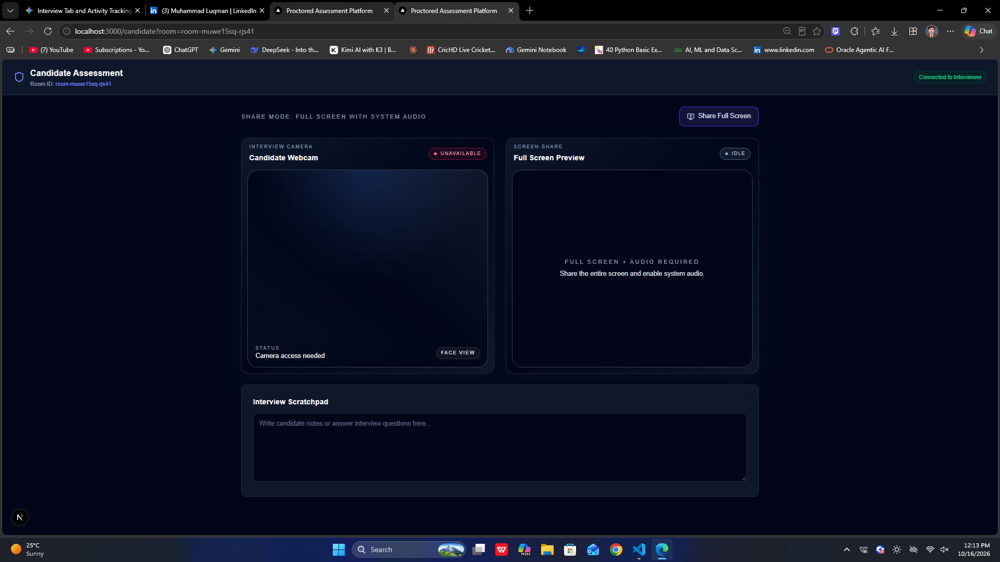
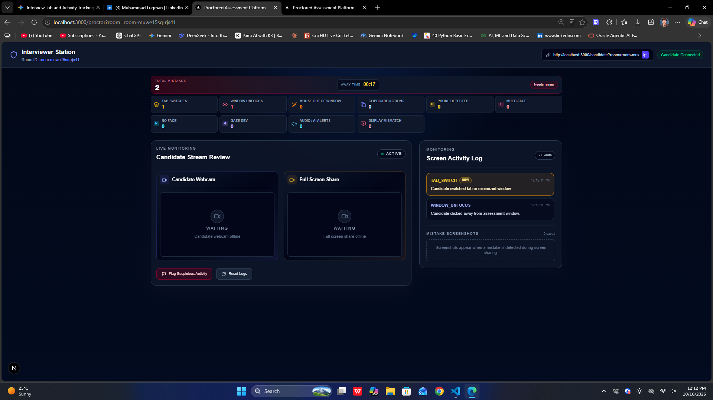

# Real-Time AI Proctoring & Candidate Monitoring Platform

A production-grade, real-time assessment and remote proctoring platform built with **Next.js**, **WebRTC**, and **MediaPipe**. Designed for automated candidate monitoring, browser telemetry tracking, and secure evidence capture.


---
## 📸 Application Screenshots

### 1. Candidate Assessment & AI Monitoring View
> Real-time webcam feed with MediaPipe face/phone detection and telemetry status.



### 2. Live Proctor Dashboard
> Real-time telemetry log, violation metrics, and remote student stream monitoring.



## 🚀 Key Features

### 1. Computer Vision & Webcam AI
* **Phone Detection:** YOLOv8n/YOLO11n ONNX inference in the browser, with a multi-frame confirmation buffer.
* **Face Presence Tracking:** MediaPipe BlazeFace full-range detection for *No Face* and *Multiple Faces* alerts.
* **Gaze & Head Pose Deviation:** 3D landmark-based PnP estimates pitch, yaw, and roll to reduce false gaze alerts.

### 2. Browser Telemetry & Activity Signals
* **Tab Switching & Unfocus:** Detects visibility changes when candidates switch tabs or click away from the assessment window.
* **Clipboard & Input Monitoring:** Logs copy, paste, and right-click context menu attempts.
* **Display Mismatch Detection:** Monitors viewport constraints (e.g., width < 1024px or split-screen/resizing behavior) with safety buffers.

### 3. Audio & System Monitoring
* **Candidate Microphone:** Candidates can explicitly enable or disable their microphone; proctors receive a separate audio stream and choose when to unmute it. While enabled, AASIST-L locally screens audio for possible synthetic speech and saves a webcam screenshot for review after repeated high-score windows.
* **Optional Screen Sharing:** Secure PeerJS/WebRTC screen video sharing when supported by the candidate's browser. Screen audio is not required.

### 4. Live Proctor Dashboard
* **Real-time Telemetry Logger:** Centralized event stream with timestamped violation logs.
* **Automated Evidence Capture:** Automatically captures and stores local screenshot evidence upon critical triggers.
* **Away-Time Tracking:** Tracks duration and frequency of candidate absence.
* **Post-Interview Integrity Report:** Candidate can finish the session to stop monitoring and submit timestamped telemetry; the proctor dashboard then links to a scorecard with the 10 violation counters, away/interview duration, interactive timeline, and saved screenshots.

### 5. Integrity Scorecard
The score starts at 100 and subtracts points for each recorded signal: phone detection (-20), multiple faces (-15), possible synthetic audio (-20), tab switch/window unfocus/no face/display mismatch (-10 each), gaze deviation (-5), and clipboard/mouse departure (-3 each). Away time over 10 seconds subtracts one point for each started 10-second block beyond the threshold, up to 20 points. Scores above 85 are low risk, 60–85 medium risk, and below 60 high risk.

This is a transparent rules-based review aid, not an AI assessment of answer credibility or proof of cheating. Browser/device signals can be inaccurate; away time means time marked away by telemetry, not verified cheating time. Detector model scores are shown only when the detector provides one and are not calibrated probabilities. The report timeline may be capped at 10,000 events; when capped, the report marks it as incomplete while preserving omitted violation counts.

Reports and screenshots are stored as JSON/images under the local `data/interviews/` and `data/evidence/` folders. This filesystem storage is suitable for local development or a single persistent server; multi-instance or ephemeral deployments need shared durable storage. The report API validates payload size, event formats, room identifiers, and same-origin finish requests. The current app has no user authentication, so a room ID is not a substitute for access control; deploy behind authenticated proctor/candidate access before storing sensitive production interviews.

---

## 🛠️ Tech Stack

* **Frontend & Backend:** Next.js (App Router), React, TypeScript
* **Styling:** Tailwind CSS
* **Real-time Communication:** PeerJS / WebRTC
* **AI / Computer Vision:** ONNX Runtime Web (YOLOv8n/YOLO11n), MediaPipe Tasks Vision (BlazeFace and FaceLandmarker)
* **Audio:** WebRTC microphone audio and experimental AASIST-L anti-spoof screening in ONNX Runtime Web

---

## 📁 Project Structure

```text
proctoring-system-app/
├── app/                  # Next.js App Router (Candidate & Proctor views)
├── components/           # UI components (Webcam, ScreenShare, Dashboard)
├── hooks/                # Custom React hooks (AI detection, WebRTC, Audio monitoring)
├── lib/                  # Evidence storage and helper utilities
├── types/                # TypeScript interfaces and global definitions
└── public/               # Static assets and model binaries

⚙️ Getting Started
Prerequisites
Node.js (v18+ recommended)

npm or yarn

Installation & Setup
Clone the repository:

Bash
git clone [https://github.com/nameluqman/ai-proctoring-system.git](https://github.com/nameluqman/ai-proctoring-system.git)
cd ai-proctoring-system
Install dependencies:

Bash
npm install
Run the development server:

Bash
npm run dev
Open http://localhost:3000 in your browser to view the application. (Note: Camera, microphone, and screen share features require a secure context or localhost setup).

### Model setup

`npm run dev` automatically downloads and SHA-256 verifies the official YOLO11n and AASIST-L ONNX models to `public/models/` on first run; subsequent runs reuse verified files. `npm run build` also prepares the models for production builds. Model files are ignored by Git and are not committed to the repository. An internet connection is required for the first download.

BlazeFace and FaceLandmarker weights are loaded client-side from the MediaPipe model hosting endpoints. Those model requests require an internet connection.

**Audio screening limitations:** AASIST-L processes the candidate's audio locally while their microphone is enabled. Two consecutive windows must score at least 90% synthetic before a `SYNTHETIC_AUDIO_SUSPECTED` event and webcam screenshot are sent for proctor review. This score is not a calibrated probability or proof of AI use. Published benchmark results vary greatly by recording conditions (including 44.45% equal-error rate on InTheWild audio); expect false alerts and missed detections, especially for speaker-to-microphone recordings. Candidate microphone audio is still transmitted to the proctor using the existing WebRTC connection.

To use a different compatible model, set `NEXT_PUBLIC_YOLO_MODEL_URL` to a same-origin path or CORS-enabled URL. This skips downloading the default YOLO11n model. The detector expects 640×640 raw detection output with the COCO `cell phone` class. The official Ultralytics pretrained weights are distributed under AGPL-3.0; review the model license before distributing the app or using it commercially.

🛡️ Heuristics & Disclaimer
Proctoring telemetry signals act as review heuristics and indicators for human proctors rather than absolute automated legal proof, ensuring balanced oversight and minimal false-penalization.

📄 License
This project is open-source and available under the MIT License.